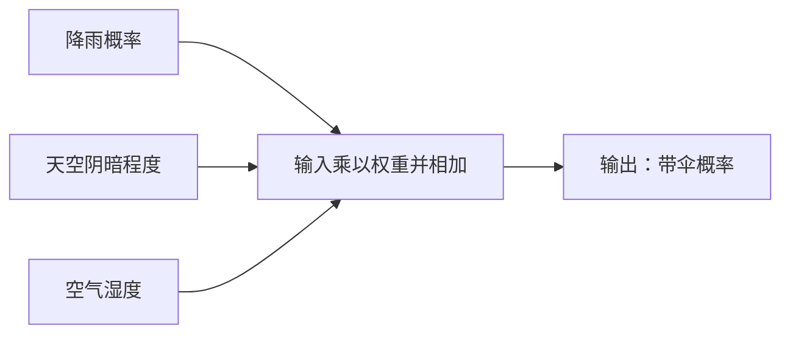

# AI 系统学习

> 让学习成为习惯。
> Make learning a habit.

最后更新：2026-10-14
当前阶段：M1 进行中，价格差额与涨幅比例示范已运行；继续检查百分比表示和新例子
学习方式：大目标 → 小任务 → 示范 → 尝试 → 具体反馈 → 下一小步

## 一、学习目标

学习者已经从 2024 年开始使用 AI，熟悉应用层操作，但尚未系统理解底层原理。2026-10-13 明确最终目标：完成一个面向全球市场的量化项目。课程围绕这个项目结合 Python、SQL、概率论与统计、数据分析和 AI，先建立直觉，再补充数学和工程实践。

完成学习后，应当能够：

1. 用自己的语言解释大模型的基本工作过程。
2. 理解 Token、向量、神经网络、Transformer、训练和推理。
3. 判断 Prompt、RAG、Agent 分别解决什么问题。
4. 看懂并运行基础 AI 示例代码。
5. 完成一个可复现的全球市场量化研究项目，解释数据、策略规则、回测假设和结果局限。
6. 理解概率、条件概率、概率分布、期望与方差，并解释它们与模型预测、训练和生成的联系。
7. 用 Python 处理行情、用 SQL 保存和查询数据，并用图表展示策略表现。

### 最终项目与第一版验收

项目暂称“全球市场量化研究工具”。第一版按历史日线数据研究与回测规划，先用少量明确选定的跨市场样例跑通流程，再逐步增加市场和资产。市场方向已确认是全球市场；具体资产、数据来源、样本区间和报告币种在数据阶段确定。初版成果是可复现的研究工具，后续模拟交易和实盘对接另行规划。

| 项目环节 | 第一版应交付的结果 | 对应学习内容 |
| --- | --- | --- |
| 获取与检查数据 | 导入历史行情，记录来源、市场、币种、时区、获取日期及价格调整口径；检查缺失、重复与异常 | Python、文件、API、数据分析 |
| 保存与查询 | 用本地 SQLite 保存资产、行情和实验结果；能用 SQL 按资产和日期查询 | 数据库、表、主键、SQL、Python 数据库连接 |
| 跨市场处理 | 保留当地交易日期和实际可用时间；按各市场日历处理休市，明确汇率与统一报告币种 | 时间处理、数据库设计、汇率数据 |
| 制定策略 | 写出可解释的简单规则、信号时间、成交时间、仓位和退出条件；建立同资产同区间的基准 | Python 函数、量化基础、实验设计 |
| 历史回测 | 模拟持仓与现金，计入适用的手续费、税费和滑点；保留交易明细和配置 | 程序设计、回测、测试 |
| 评估结果 | 展示净值、累计收益、最大回撤、波动及与基准的比较，说明指标口径 | 概率论、统计、可视化、风险分析 |
| 检查可靠性 | 按时间划分策略开发区间和保留测试区间；检查未来数据、幸存者偏差和参数敏感性 | 时间序列、数据审计、软件测试 |
| 使用 AI | 用 AI 辅助解释代码和撰写基于计算结果的报告；后续增加一个简单机器学习实验，与规则基线比较 | AI 原理、模型评估、Prompt |
| 可复现交付 | 保存代码、数据快照或重建方法、参数、依赖、运行说明与报告；同一配置能重现结果 | Git、工程实践、文档 |

完成标准是这些环节能运行、能核对、能解释；策略亏损也应如实记录。收益目标不是第一版的验收条件。AI 模型是否带来改进，需要在保留测试区间验证。

全球市场的处理约定：不把休市日填成真实成交行情；不同币种先分别计算，再按明确的汇率口径汇总；每个信号只能使用当时已经可获得的信息。第一版优先学习日线研究，后续按所选市场补充交易规则。

回测参考：[Freqtrade 关于未来数据偏差的说明](https://www.freqtrade.io/en/stable/lookahead-analysis/)、[Backtrader 滑点说明](https://www.backtrader.com/docu/slippage/slippage/)、[Backtrader 费用模型说明](https://www.backtrader.com/docu/commission-schemes/commission-schemes/)。这些资料用于理解检查项，尚未选定回测框架。

## 二、学习习惯

固定学习时间：

- 每天 06:00：学习入口，阅读一个短例子；不要求每天推进新概念。
- 每天 19:00：复习当前主题，有精力时完成一个小练习。
- 正式学习每次建议 5–10 分钟，只安排一个主要任务；提醒中的最小一步控制在 1 分钟左右。
- 时间不足时：读懂一句解释即可；漏掉的提醒不用补。

使用“1-1-1 学习法”：

1. 学习 1 个概念。
2. 完成 1 个例子。
3. 用自己的话总结 1 句话。

核心原则：让学习容易开始，不把提醒变成作业积压。先讲解，再练习；收到提醒不代表完成学习。没有学习者反馈时，不自动升级课程，也不连续重复同一道填空题。

### 大目标、小步快跑

大目标始终是全球量化项目。每次只拿出一个当前能完成的小任务，做完就留下一个可检查的成果：一句解释、一段代码、一条查询或一张图。课程主题用于指路，实际推进按下表中的小任务进行。

| 里程碑 | 拆成的小任务示例（分多次完成） | 可见成果 |
| --- | --- | --- |
| M1：第一次计算 | 用变量保存一个价格 → 打印价格 → 手算一次涨跌幅 → 用程序计算 → 换一个例子验证 | 一个能算简单收益率的小程序 |
| M2：第一次存取数据 | 认识一行行情 → 保存 3 行模拟数据 → 建表 → 插入数据 → 按日期查询 | 一张行情表和一条查询 |
| M3：第一次分析 | 读入一小段数据 → 检查缺失 → 画价格曲线 → 算平均值 → 用例子认识波动 | 一张图和一段自己的解释 |
| M4：第一条规则 | 用一句话写规则 → 计算所需指标 → 生成一个信号 → 检查信号只能用当时的信息 | 可解释、可核对的策略信号 |
| M5：第一次回测 | 模拟一次买卖 → 记录持仓与现金 → 扣一次费用 → 加入滑点假设 → 和基准比较 | 一份交易记录和回测结果 |
| M6：跨市场实验 | 接入一个市场 → 再接入另一个市场 → 核对交易时间 → 标记币种 → 处理汇率与休市 | 小范围跨市场实验 |
| M7：验证与报告 | 留出测试区间 → 核对回撤 → 改一个参数比较 → 做一个简单模型实验 → 核对 AI 辅助生成的报告 | 可复现的代码、配置与报告 |

每个箭头之间都可以停下来，不要求一次完成一整行。根据实际理解调整步幅；顺利时进入相邻任务，卡住时换例子或把任务再拆小，不补一长串前置课程。

每次学习采用同一节奏：说明今天要做成什么 → 示范一个完整例子 → 学习者只尝试一小步 → 核对结果并给予具体反馈 → 给出下次入口。完成当前小任务即可收工，继续学习是可选项。

终端跟练方式（2026-10-14 调整）：学习者提出希望直接持续检查。在当前对话正在进行的学习轮次中，助手间隔约 15–20 秒读取当前聊天的内置终端，观察到执行结果后直接反馈并给相邻小步骤；不要求每条命令后都发送“好了”。发生输入错误时，一次只提供一条命令。读取仅用于当前学习，结束该轮后不表示仍有后台监控，定时学习提醒也不自动运行命令或检查终端。

### 鼓励机制

1. **及时、具体地肯定行动**：指出真实完成的内容及其用途，例如“你把价格保存进变量了，这是处理行情的第一步”。提问、认真尝试和纠正错误同样值得肯定。
2. **错误之后给可执行提示**：先指出已经正确的部分，再只解释当前一个卡点，用更小的例子帮助重试。练习的正确性仍如实反馈。
3. **用成果庆祝里程碑**：满足上表成果并经过检查后，再记录“第一次计算完成”等里程碑；可用一颗成果星作轻量标记，不设排名或积分门槛。
4. **区分参与和掌握**：尝试过、运行成功、能解释原理分别记录。读过提醒不会自动获得完成标记，也不会被算成学会。
5. **允许暂停和重新开始**：漏学不扣分、不清零、不安排补课债；回来时从一个最小任务继续。仅在收到实际学习反馈后更新进度。

当前里程碑状态：M1 进行中，变量赋值、更新、打印、价格差额及涨幅比例示范已在学习者终端运行成功；百分比表示和新例子待检查。M2–M7 待开始。运行结果与独立解释原理分别记录。

## 三、系统学习路线

路线于 2026-10-13 调整：以全球市场量化项目为主线，编程、数据库、概率与 AI 交替学习。后文旧课号保留为历史笔记编号，不等同于路线阶段号。已发送的讲解不代表学习者已掌握。

| 阶段 | 主题 | 核心问题与小目标 | 状态 |
| --- | --- | --- | --- |
| 0 | 目标与量化入门 | 用数据和明确规则研究问题；读懂价格、收益率与回测 | 项目目标已确认，概念待学习 |
| 1 | Python 基础 | 变量、数字、列表、条件、循环、函数；计算一组模拟价格的收益率 | 学习中；赋值、打印、减法和收益率示范已运行，独立理解待确认 |
| 2 | SQL 与数据库 | 建立资产和行情表；用 SELECT、WHERE、ORDER BY、GROUP BY 查询；Python 连接 SQLite | 待学习 |
| 3 | 数据分析与图表 | 导入 CSV、清洗数据、处理日期、计算简单指标并画价格曲线 | 待学习 |
| 4 | 概率论与统计基础 | 概率与频率、条件概率、独立性、贝叶斯、分布、期望、方差与抽样 | 概率与频率已讲解，待反馈；其余待学习 |
| 5 | 全球市场数据 | 接入小范围历史数据，明确时间、日历、币种、复权和样本选择 | 待学习 |
| 6 | 策略与回测 | 实现简单规则与基准，处理仓位、成交时间、费用、滑点和交易记录 | 待学习 |
| 7 | 评估与验证 | 收益、回撤、波动；按时间保留测试数据，检查泄漏、过拟合与偏差 | 待学习 |
| 8 | AI 与机器学习实验 | 复习参数、损失、训练与推理；用简单模型构建一个可检验实验 | 训练与推理有作答记录；模型实验待学习 |
| 9 | 大模型基础与应用 | Token、向量、Transformer、条件概率与生成；用 AI 辅助代码、解释和报告 | 历史基础待复习；量化应用待学习 |
| 10 | 项目交付 | 整合数据、数据库、策略、评估与报告，提供可复现运行说明 | 待实施 |
| 11 | 按需扩展 | 网页/API、RAG、Agent、更多资产与模拟交易；根据项目需求选择 | 后续扩展 |

从第一段代码开始少量使用 Git 和测试。概率课穿插在数据分析与策略例子中，不要求先学完所有数学再动手；复杂模型在简单基准可运行、可核验后再加入。

### 概率论怎样学、怎样用

每行拆成若干小课，一次只引入一个主要概念。先用实物和整数计数，再引入符号；代码实验放在手算例子之后。

| 小单元 | 通俗例子 | 与 AI 的连接 | 理解检查 |
| --- | --- | --- | --- |
| 事件、概率与频率 | 公平硬币出现正面的概率是 1/2，但掷 10 次不保证恰好 5 次正面 | 概率描述不确定性，不是对单次结果的保证 | 解释为什么短期频率可能偏离概率 |
| 条件概率与独立性 | 20 个球中有 8 个红球、10 个大球，其中 6 个既红又大；等可能抽一个球，已知红色后只在这 8 个球里计算 | 模型根据输入和上下文作出条件预测 | 区分“红球中大球的比例”与“大球中红球的比例” |
| 贝叶斯公式 | 用垃圾邮件的占比，以及垃圾邮件和正常邮件中某关键词出现的比例，更新判断 | 理解先验、证据与后验；不把所有模型都当成显式贝叶斯分类器 | 能指出原有判断、新证据和更新后判断 |
| 随机变量、分布、期望与方差 | 公平六面骰子点数的期望是 3.5，但一次不会掷出 3.5；比较平均值相同、波动不同的结果 | 理解预测分布、平均损失与结果波动 | 分清平均表现与单次结果 |
| 抽样与大数定律直觉 | 比较掷硬币 10 次与 1000 次；更多样本通常更稳定，不保证每增加一次都更接近 1/2 | 理解数据量、样本代表性与测试结果的不确定性 | 知道增加样本不自动消除抽样偏差 |
| 概率在大模型中的应用 | 给几个候选 Token 分配总和为 1 的概率，再选择或采样 | 连接条件概率、softmax、温度、交叉熵和生成过程 | 解释“下一个 Token 概率高”不等于“整段回答事实正确” |

连接量化时，先用模拟数据练习收益率、平均值与波动，再讨论胜率、盈亏幅度、相关性和时间序列。平均收益需要同时计算盈利与亏损的大小；胜率高不保证总收益为正。使用模型输出的概率前，要通过独立于训练的数据检查它是否可信。

数学补充顺序：分数与百分比 → 加权平均 → 简单代数 → 向量与点积 → 对数、斜率和导数直觉。连续分布与更严格的公式推导留作后续扩展，不作为开始学习 AI 的门槛。

建议每完成 2–3 次正式学习，就安排一次复习；进度根据实际回答调整，不设固定天数赶完。进入下一阶段前，用一个新例子检查理解，答错时先换一种解释，不机械重复出题。

## 四、核心工作流程

项目主流程：获取历史数据 → Python 检查与处理 → SQL 保存和查询 → 策略生成信号 → 回测持仓与成本 → 评估和图表 → 研究报告。AI 在可核验的数据和结果基础上辅助研究，后续再加入机器学习策略实验。

后续逐步展开的大模型文字处理流程（现在不要求背诵）：

```text
文字
  ↓
Token
  ↓
Token 编号
  ↓
向量（Embedding）
  ↓
神经网络与 Transformer 计算
  ↓
下一个 Token 的概率
  ↓
逐步生成回答
```

这张流程图会随着后续课程逐层展开。

## 五、课程笔记

### Python 小任务 1：保存、更新和显示价格（2026-10-14）

学习者在当前聊天的内置终端执行 `python3`，进入 Python 交互环境，并依次执行：

```python
price = 100
price = 102
print(price)
```

助手读取实际终端输出，确认结果为 `102`，终端仍停留在 `>>>` 提示符。

讲解：`price` 是变量名，`=` 表示赋值。第二行把变量的值更新为 102；`print(price)` 显示它当前保存的值。交互环境里的 `>>>` 是提示符，不属于需要输入的代码。

具体反馈：你已经亲手跑通“保存价格 → 更新价格 → 显示结果”，这是后续处理行情的一小步。

状态：示范代码已由学习者实际运行成功；尚未用新例子或自主解释确认独立掌握。当前只确认该小任务，不标记整个 M1 或 Python 基础已完成。

后续练习：分别保存前一天和当天的模拟价格，用减法计算差额，执行结果见下一小任务。

### Python 小任务 2：计算价格差额（2026-10-14）

学习者在同一 Python 交互环境中保存两个价格，并计算差额：

```python
previous_price = 100
current_price = 102
print(current_price - previous_price)
```

助手读取实际终端输出，确认两个赋值已执行，差额结果为 `2`，随后回到 `>>>` 提示符。含义是模拟价格从 100 到 102，上涨了 2 个单位。

实际输入时，学习者在 `print(...)` 的右括号输入前换行，终端出现 `...`。这表示 Python 正在等待尚未结束的语句；在后续行补上 `)` 后，程序正常输出 `2`，此次没有执行报错。

具体反馈：你已亲手完成两个变量的保存和减法计算，还补齐了括号，让程序成功执行。价格差额这一小任务已完成。

本任务完成时的状态：差额计算已实际运行并检查。之后的收益率练习见下一小任务。

### Python 小任务 3：计算涨幅比例（2026-10-14）

讲解：从 100 到 102，差额为 2，相对于原价格的比例为 `2 / 100 = 0.02`，即 2%。Python 中 `/` 表示除法，括号让差额先算出来：

```python
change_rate = (current_price - previous_price) / previous_price
print(change_rate)
```

助手在该轮中持续间隔读取终端，确认学习者最终执行上述两条命令，实际输出为 `0.02`。

实际遇到的输入问题与反馈：

- 将数学说明 `102 - 100 = 2` 输入 Python，出现赋值语法错误；已解释这只是算式说明，可执行表达式写为 `print(102 - 100)`。
- 将赋值与打印接在同一行，出现语法错误；改为每次只输入一条命令，赋值后回到 `>>>`。
- 输入 `print)chang_rate)`，括号方向错误；随后输入 `print(chang_rate)`，出现 `NameError`，因为变量名少了 `e`；最终改为 `print(change_rate)`，正常输出 `0.02`。

具体反馈：你已经逐个修正输入问题，亲手把两个价格转成了涨幅比例。计算结果已验证，独立解释公式与新例子仍待确认。

随后安排 `print(change_rate * 100)`：`*` 是乘法，预期显示 `2.0`，表示百分比中的数字 2；该打印步骤等待实际终端检查。

### 重新起步：训练和使用模型（2026-09-05）

学习者说明此前并未实际完成学习，因此旧课程和作答保留作参考，原有“通过”判断不作为当前掌握情况。收到提醒、读过讲解或答对填空，都不能单独证明已经理解。

今天只理解两个过程，继续沿用猫狗图片的例子：

1. **训练**：给模型看很多带有“猫”或“狗”标签的图片。模型先尝试判断，再把结果与标签比较，根据差距调整内部参数。参数可以暂时理解成控制计算方式的一组数字。
2. **推理**：给训练后的模型看一张新图片，让它利用已有参数判断是猫还是狗。普通推理通常不会更新参数，但仍然可能判断错误。

生活类比：训练像平时做练习并订正，推理像用学到的方法解一道新题。

一句话：训练是在学习规律，推理是在使用学到的规律。

可选练习：模型第一次看到一张新猫照片，并判断“这是猫”，这属于训练还是推理？

学习者回答（2026-09-06）：“推理”。

反馈：回答正确。这个例子是在使用已有参数判断新照片，没有根据答案调整参数。

当前状态：已正确辨认这个推理例子；尚未通过更多例子确认能独立区分训练与推理。

### 第 0 课：AI 分类与 Codex 的位置

AI 是一个很大的技术领域。先把底层技术关系和产品形态分开：

```text
人工智能（AI）
└── 机器学习（Machine Learning）
    └── 深度学习（Deep Learning）
        └── 生成式 AI（Generative AI）
            └── 大语言模型（LLM）
```

AI Agent 不是大语言模型下面的一个“模型种类”，而是一种产品系统：

```text
大语言模型 + 目标 + 工具 + 环境 + 权限 + 验证 = AI Agent
```

上面的关系仍是一张方便初学者理解的简化图，不表示所有 AI 技术都只能按照这一条路线分类。

#### 用三条独立维度理解 AI

“软件、物理、通用、专用、服务、端侧”不是六个并列种类，而是三条可以组合的分类维度：

| 分类维度 | 一端 | 另一端 | 它回答的问题 |
| --- | --- | --- | --- |
| 作用空间 | 软件 AI | 物理 AI | AI 主要处理数字信息，还是感知并作用于现实世界？ |
| 能力范围 | 通用大模型 | 专用或垂直大模型 | 能力覆盖很多任务，还是重点解决某个领域的问题？ |
| 部署方式 | 云端大模型服务 | 端侧大模型 | 模型推理主要在远程服务器，还是在手机、电脑或设备本地完成？ |

需要注意：

1. 三行之间可以自由组合。例如，一套工业巡检机器人可以是“物理 AI + 专用模型 + 端云混合部署”。
2. 每一行都不是绝对二选一。很多系统既有通用能力，也做了行业强化；既使用云端模型，也在本地运行一部分能力。
3. 物理 AI 仍然需要软件。这里的“物理方向”强调的是它能通过机器人、汽车或设备感知并影响现实世界。
4. “专用大模型”也常叫“垂直大模型”或“领域模型”。专用 AI 系统既可以使用经过领域训练或微调的专用模型，也可以使用通用模型加上 Prompt、RAG、工具和业务流程。后一种情况下，应用变得专用，但底层模型不一定变成了专用模型。

几个组合例子：

| AI 系统 | 作用空间 | 能力范围 | 部署方式 |
| --- | --- | --- | --- |
| 通用云端聊天助手 | 软件 AI | 通用 | 云端服务 |
| 手机离线翻译 | 软件 AI | 专用 | 端侧 |
| 工业巡检机器人 | 物理 AI | 专用 | 端侧或端云混合 |
| Codex | 软件 AI | 通用能力底座上的编程专业化 Agent | 模型服务为主，本地工具可执行文件和命令 |

#### Codex 在三条维度上的位置

Codex 可以从四个层面理解：

1. **作用空间**：属于软件 AI，主要处理代码、文档和软件工程任务。
2. **能力范围**：底层具有较广的语言与推理能力，但模型或产品又针对编程 Agent 任务进行了专业化。因此，它不是简单的“纯通用”或“纯专用”。
3. **部署方式**：目前主要依赖大模型服务进行推理；本地 Codex 可以在授权范围内读写文件和运行工具。这叫“云端模型推理 + 本地工具执行”，不等于把完整大模型放在电脑上离线运行。
4. **产品形态**：属于能够使用工具、读取文件并完成多步任务的 AI Agent。

模型主要负责生成和推理；Agent 则在模型之外增加任务目标、工具、环境、权限边界和验证流程。因此，Codex 不只是一个聊天模型，更准确的说法是“由大语言模型驱动的编程 Agent”。OpenAI 官方将 Codex 定位为 coding agent。

官方参考：[OpenAI Developers](https://developers.openai.com/)；[GPT-5-Codex 模型说明](https://developers.openai.com/api/docs/models/gpt-5-codex)

本课一句话总结：

> Codex 是软件方向的 AI：以大模型服务为核心，在通用能力基础上强化编程，并通过本地工具完成工程任务。

### 第 1 课：Token

#### 1. 什么是 Token

Token 是文字进入大模型之前，被切分出来的基本处理单位。

例如：

```text
我今天开始学习 AI。
```

经过分词器后，可能被切分为：

```text
我｜今天｜开始｜学习｜AI｜。
```

具体切分结果取决于模型使用的分词器。Token 不一定等于一个汉字、一个词或一个英文单词。

#### 2. 模型实际处理什么

模型不能直接计算文字。分词器会先把 Token 映射为编号：

```text
文字 → Token → Token 编号
```

编号只是身份标签，本身不表示词义，也不存在“编号越大、含义越重要”的关系。

#### 3. Token 为什么重要

- 模型上下文窗口通常以 Token 数量计算。
- 输入和输出过长时，会占用更多上下文空间。
- 很多 AI 接口按 Token 统计使用量。
- 对话过长后，较早内容可能超出上下文范围。

#### 4. 本课一句话总结

> Token 是大模型读取文字时使用的基本单位。

#### 5. 本课练习

用自己的语言回答：Token 是什么？为什么模型不能直接处理原始文字？

学习者第一次回答（2026-09-01）：

> 一段带编号的特征。

反馈：这句话把 Token、Token 编号和向量混在了一起。Token 是文字被切分后的基本处理单位；Token 编号是它的身份标签；向量才用于表示特征和语义关系。

学习者第二次回答（2026-09-02）：

> 切分。

反馈：填空正确，已经能够复述“Token 是文字被切分后的基本处理单位”。

原因题第一次回答（2026-09-02）：

> 模拟。

反馈：“模拟”可以描述模型表现出来的效果，但不是神经网络内部计算的数据形式。神经网络实际执行的是大量数值计算，所以文字需要先转换成编号和向量。

学习者完整复述（2026-09-02）：

> 文字，切分成 Token，赋予编号，记住向量，进行数值计算。

反馈：整体流程正确。“记住向量”更准确地说是“转换成向量”或“查表得到向量”。规范表达为：文字 → 切分成 Token → 映射为编号 → 转换成向量 → 进行数值计算。

历史反馈：当时标记为“基础复述通过”。2026-09-05 根据学习者反馈改为待复习确认。

### 第 2 课：向量与 Embedding

#### 1. 为什么 Token 编号还不够

假设：

```text
苹果 → 125
香蕉 → 807
汽车 → 212
```

这些编号只用于区分 Token，无法表示“苹果和香蕉的含义比苹果和汽车更接近”。因此，模型还要把 Token 转换成向量。

#### 2. 什么是向量

向量可以暂时理解为一个事物在“含义地图”上的坐标。真实向量可能包含几百或几千个数字：

```text
苹果 → [0.21, -0.73, 0.42, ...]
```

模型可以通过这些数字计算 Token 之间的关系。在这张抽象地图中，用法或含义相近的内容通常会形成更接近的表示。

#### 3. 什么是 Embedding

Embedding 是把 Token、句子或其他对象转换为向量表示的过程或结果。

```text
Token 编号 → Embedding → 向量
```

#### 4. 上下文为什么重要

同一个词在不同句子中可能表达不同含义：

```text
我吃了一个苹果。
苹果发布了新手机。
```

模型后续需要使用 Transformer 结合上下文，判断“苹果”指水果还是公司。

#### 5. 本课一句话总结

> Token 让模型区分文字，向量让模型计算文字之间的关系。

#### 6. 本课练习

回答：为什么不能只使用 Token 编号，而需要把 Token 转换成向量？

学习者回答（2026-09-01）：

> 因为不是一样的类别。

反馈：方向正确。苹果和香蕉属于水果，汽车属于交通工具。还需要补充关键原因：Token 编号只是身份标签，不保存类别和含义；向量才可以表示特征，并让模型计算含义之间的相似程度。

第一次验收状态：已理解类别差异，待用完整一句话说明“编号与向量的区别”。

学习者补充回答（2026-09-01）：

> Token 编号只能是身份证号，向量可以表示特征。

历史反馈：当时标记为“基础复述通过”。2026-09-05 根据学习者反馈改为待复习确认。这里的“身份证号”是类比；Token 编号只用于识别 Token，向量用于表示特征和语义关系。

### 第 3 课：神经网络入门

#### 1. 什么是神经网络

神经网络是一种由许多计算单元连接起来的数学模型。它接收一组数字作为输入，经过多层计算后产生输出。

“神经网络”这个名字受到生物神经系统启发，但人工神经元不是人脑里的真实神经元。初学阶段可以先把它理解成许多能够调整参数的小计算器连接在一起。

#### 2. 一个神经元怎样做判断

以“今天要不要带伞”为例，模型可以接收这些输入：

- 天气预报中的降雨概率。
- 天空阴暗程度。
- 空气湿度。

每项输入都有一个权重，表示模型认为这项信息有多重要。一个神经元会完成类似下面的计算：

```text
输出 = 激活函数（输入1 × 权重1 + 输入2 × 权重2 + 输入3 × 权重3 + 偏置）
```

现在不需要背公式，只需记住：输入提供信息，权重表示重要程度，计算结果形成输出。偏置可以暂时理解成模型原本的判断倾向。



#### 3. 神经网络怎样学习

在最容易理解的监督学习例子中，神经网络会反复执行下面的过程：

```text
接收训练样本
→ 给出预测
→ 与正确答案比较
→ 计算误差
→ 稍微调整权重和其他参数
→ 使用更多样本继续练习
```

如果调整后误差变小，就说明调整方向有帮助。经过大量重复，网络中的参数逐渐能够表示数据里的规律。这个过程叫训练；训练完成后，用已经学到的参数处理新输入叫推理。

#### 4. 什么是深度学习

一个神经元只能完成很简单的判断。大量神经元组成一层，多层神经网络可以逐步提取更复杂的特征。“深度学习”中的“深度”，主要指神经网络具有许多计算层。

#### 5. 本课一句话总结

> 神经网络通过数据反复练习，并调整权重等参数，让预测误差逐渐变小。

#### 6. 本课练习

填空：神经网络通过不断比较预测与正确答案，调整 ______，让误差变小。

学习者回答（2026-09-02）：

> 权重。

历史反馈：当时标记为“基础复述通过”。2026-09-05 根据学习者反馈改为待复习确认。“权重”是正确答案；更广义地说，训练会调整权重、偏置等模型参数。

## 六、基础术语表

| 术语 | 初学阶段的理解 |
| --- | --- |
| AI | 让机器完成通常需要人类智能的任务的技术集合 |
| 模型 | 从数据中学到规律、可以接收输入并产生输出的计算系统 |
| 大语言模型（LLM） | 以大量文本训练、能够预测和生成语言的模型 |
| Prompt | 用户提供给模型的输入、问题或指令 |
| Token | 模型读取文字时使用的基本单位 |
| Token 编号 | 分词器为每个 Token 分配的身份标签 |
| 向量 | 用一组数字表示对象特征或关系的形式 |
| Embedding | 将 Token、句子等对象转换为向量表示 |
| 上下文窗口 | 模型一次能够处理的 Token 范围 |
| 幻觉 | 模型生成了流畅但不可靠或不真实的内容 |
| AI Agent | 以模型为核心，能够围绕目标调用工具并执行多步任务的系统 |
| Codex | 偏向编程和工程协作的大语言模型驱动型 AI Agent |
| 软件 AI | 主要在数字世界中处理文字、图像、代码或业务流程的 AI |
| 物理 AI | 通过机器人、车辆或设备感知并作用于现实世界的 AI |
| 通用大模型 | 能够处理多种领域和任务的大模型 |
| 专用或垂直大模型 | 经过领域数据训练或微调，重点服务某个领域或任务的大模型 |
| 专用 AI 应用 | 面向特定领域或任务构建的应用，底层可以使用通用模型或专用模型 |
| 大模型服务 | 通过云端服务器或 API 提供模型推理能力 |
| 端侧大模型 | 主要在手机、电脑、汽车或其他本地设备上进行推理的模型 |
| 神经网络 | 由许多计算单元连接而成、能够通过调整参数学习规律的数学模型 |
| 权重 | 表示某项输入或连接在计算中有多重要的参数 |
| 偏置 | 帮助神经元调整判断起点的参数 |
| 误差或损失 | 用来衡量模型预测与目标答案之间差距的数值 |
| 训练 | 使用数据不断计算误差并调整模型参数的过程 |
| 推理 | 使用训练得到的参数处理新输入并产生结果的过程 |

## 七、学习记录

以下旧记录保留当时的讲解和作答过程；学习者已于 2026-09-05 说明此前没有实际完成学习，旧记录中的理解或通过判断不代表当前已掌握。

| 日期 | 学习内容 | 结果 | 下一步 |
| --- | --- | --- | --- |
| 2026-08-29 | 建立学习习惯与“1-1-1 学习法” | 已建立每日学习节奏 | 坚持每日不断线 |
| 2026-08-29 | AI 分类与 Codex 的位置 | 理解模型与 Agent 的初步区别 | 后续学习完整 AI 全景 |
| 2026-08-29 | Token 基本概念 | 已完成讲解 | 用自己的语言复述 |
| 2026-08-29 | 向量与 Embedding 入门 | 已完成第一轮讲解 | 回答本课练习 |
| 2026-08-30 | AI 的三条分类维度 | 能区分作用空间、能力范围和部署方式 | 用三条维度分析新的 AI 产品 |
| 2026-09-01 | 向量练习第一次回答 | 已意识到不同事物存在类别差异 | 用一句完整的话说明编号与向量的区别 |
| 2026-09-01 | 向量练习补充回答 | 已准确区分 Token 编号和向量 | 复述 Token 的定义 |
| 2026-09-01 | Token 第一次复述 | 暂时混淆 Token、编号和向量 | 只说明 Token 是什么 |
| 2026-09-02 | Token 定义第二次复述 | 已正确说明 Token 来自文字切分 | 回答模型为什么要把文字转换成数字 |
| 2026-09-02 | Token 原因题第一次回答 | 暂时混淆模型效果与内部计算形式 | 记住神经网络进行数值计算 |
| 2026-09-02 | Token 完整流程复述 | 已串联文字、Token、编号、向量和数值计算 | 进入神经网络入门 |
| 2026-09-02 | 神经网络入门 | 已完成输入、权重、误差、训练和推理的第一轮讲解 | 回答权重填空题 |
| 2026-09-02 | 神经网络权重练习 | 正确回答神经网络通过调整权重减小误差 | 学习误差如何指导参数调整 |
| 2026-09-05 | 学习进度重新确认 | 学习者说明此前未实际完成学习；旧通过状态改为待复习 | 从训练与推理重新起步 |
| 2026-09-06 | 辨认推理例子 | 正确回答新照片分类属于“推理”；只确认该例子 | 用其他例子检查理解 |
| 2026-09-23 | 推理与训练练习 | 将答错但不调整参数识别为“推理”；把根据标签调整参数称为“学习”，已补充正式名称“训练” | 继续理解参数 |
| 2026-09-24 至 2026-10-02 | 参数、乘法模型与损失的提醒讲解 | 已发送例子，尚无相应练习反馈，不计为已掌握 | 在正式学习时确认理解 |
| 2026-09-30 | 学习节奏反馈 | 学习者询问“什么情况”；已说明提醒重复、缺少课程推进的问题 | 避免机械出题和凭提醒自动推进 |
| 2026-10-02 | 调整系统学习计划 | 按学习者要求将概率论纳入路线；计划更新不等于课程完成 | 开始概率、频率与不确定性入门 |
| 2026-10-07 至 2026-10-13 | 概率、频率、独立投掷与测试正确率的提醒讲解 | 已发送硬币、骰子和图片测试例子，尚无学习作答反馈 | 在正式学习中确认理解 |
| 2026-10-13 | 扩大学习范围 | 学习者要求结合 AI、Python 和数据库语言；概率论继续保留 | 把知识用于同一个项目 |
| 2026-10-13 | 明确最终目标与市场 | 学习者明确“最终目标就是完成一个量化项目”，并选择全球市场；已更新路线和验收目标 | 从 Python 变量与模拟价格开始 |
| 2026-10-13 | 确定推进与鼓励机制 | 学习者要求“大目标小步快跑，采用鼓励机制”；已加入 5–10 分钟任务、成果里程碑和具体反馈规则 | M1 第一步：用变量保存一个价格 |
| 2026-10-14 | 第一次终端练习 | 学习者执行变量赋值、更新与打印；助手读取终端，确认 `print(price)` 输出 102 | 保留两个价格并计算差额 |
| 2026-10-14 | 价格差额练习 | 终端确认 102 − 100 输出 2；学习者在续行提示下补齐括号，执行成功 | 学习差额与涨跌幅比例的区别 |
| 2026-10-14 | 涨幅比例跟练与连续检查 | 根据学习者要求在本轮间隔读取终端；修正输入问题后确认 `print(change_rate)` 输出 0.02 | 检查百分比表示，再换新例子 |

## 八、下一课

当前跟练：检查 `print(change_rate * 100)` 的实际输出，解释小数比例与百分比的转换。

之后用一个新的模拟价格例子练习公式，逐条输入、逐步检查；确认结果后记录 M1 的运行成果，再让学习者用一句自己的话解释公式。

模拟价格从 100 到 102 的简单收益率为 2%，尚未计入交易成本。完成该例子后，再用一个新例子检查理解，确认后记录 M1 成果。

本轮正在进行时，由助手间隔读取最新终端，学习者不必逐条发送完成消息；结束一轮后可以发送“继续”重新开始跟练。练习由学习者亲手输入。

由助手先讲解并提供例子，再检查理解，不要求学习者自行查找尚未讲过的答案。已有 AI 与概率笔记作为复习材料，按项目需要穿插；收到学习提醒不改变掌握状态。

## 九、文档维护规则

每完成一课，都要同步更新本文件：

1. 补充课程概念、例子和一句话总结。
2. 记录练习题、学习者回答和纠正内容。
3. 更新路线表中的学习状态。
4. 在学习记录中写明日期、结果和下一步。
5. 概念未通过复述或实践验证时，不标记为“已掌握”。
6. 记录实际完成的小任务和具体鼓励反馈，区分参与、结果正确与理解原理；提醒不产生完成记录。
